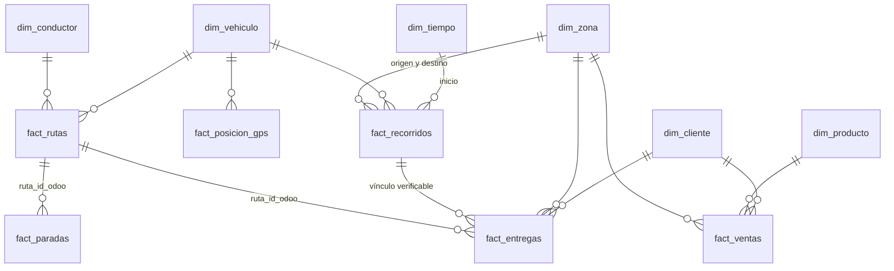

# ETL: Odoo + Traccar → staging → Data Warehouse

Copia los datos operativos de Odoo y de Traccar a un Data Warehouse dimensional en PostgreSQL. De ahí leen el panel BI (`services/bi`) y el modelo de predicción (`services/ml`). El ETL nunca escribe en Odoo ni en Traccar.

Cubre la sección 10 de [la especificación](../../docs/flujo_funcional_odoo_traccar.md) y el criterio 12 de su sección 13.

## Cómo se usa

Todos los comandos se lanzan desde la raíz del repositorio.

| Qué | Comando |
|---|---|
| Crear bases, roles y tablas | `docker compose --profile etl run --rm etl bootstrap` |
| Una corrida completa | `docker compose --profile etl run --rm etl run --mode full` |
| Una corrida incremental | `docker compose --profile etl run --rm etl run` |
| Histórico simulado para el modelo | `docker compose --profile etl run --rm etl simulate --dias 30` |
| Corridas periódicas | `docker compose --profile analitica up -d etl-scheduler` |
| Ver corridas, rechazos y marcas de agua | `docker compose --profile etl run --rm etl report` |
| Aplicar la retención de staging | `docker compose --profile etl run --rm etl purge` |
| Pruebas | `docker compose --profile etl run --rm --entrypoint pytest etl -q` |

Primera vez:

1. Definir en `.env` las claves `ODOO_PASSWORD` (o `ODOO_ADMIN_PASSWORD`), `ETL_STG_PASSWORD`, `DWH_ETL_PASSWORD` y `DWH_DB_PASSWORD`.
2. `bootstrap`.
3. `run --mode full`, o arrancar `etl-scheduler`, que hace la primera carga completa él mismo.

**Al actualizar el código del ETL**, hay que correr `bootstrap` una vez antes de la siguiente corrida. Con el `etl-scheduler` en marcha, cada ciclo falla («column does not exist») hasta que se haga. Las columnas nuevas de `fact_recorridos` (ruta y coordenadas) llegan así sin `--reset`. La siguiente corrida completa las rellena para los viajes de los últimos `ETL_TRACCAR_DAYS` días; los anteriores quedan con esas columnas vacías.

Si las bases vienen de la versión anterior del ETL, `bootstrap` se detiene y pide `bootstrap --reset`. Ese comando **borra y recrea** `logistica_staging` y `logistica_dwh`. Sus datos son derivados: se recuperan con `run --mode full` y `simulate`.

Códigos de salida: `0` correcto, `1` fallo, `2` falta configuración, `3` ya hay otra corrida en curso.

### Variables

| Variable | Por defecto | Para qué |
|---|---|---|
| `ODOO_PASSWORD`, `TRACCAR_PASSWORD` | obligatorias | Lectura de las dos fuentes. |
| `ETL_STG_PASSWORD`, `DWH_ETL_PASSWORD` | obligatorias | Roles `etl_stg` y `dwh_etl`. |
| `DWH_DB_PASSWORD` | vacía | Rol de solo lectura `dwh_ro` (BI y ML). Vacía: no se crea. |
| `DWH_ADMIN_DSN` | obligatoria para `bootstrap` | Administrador del servidor PostgreSQL. |
| `ETL_INTERVAL_MIN` | 15 | Minutos entre corridas del programador. |
| `ETL_FULL_HOURS` | 24 | Cada cuántas horas el programador hace una corrida completa. |
| `ETL_RETENTION_DAYS` | 30 | Días que se conserva el crudo de staging. 0 = no se borra. |
| `ETL_TRACCAR_DAYS` | 30 | Días hacia atrás de la primera lectura de Traccar. |
| `ETL_TZ` | America/Guayaquil | Zona horaria de la operación. |

## Cómo funciona

```mermaid
flowchart LR
    O[Odoo<br/>XML-RPC] --> E[Extracción]
    T[Traccar<br/>API REST] --> E
    E --> S[(logistica_staging<br/>crudo, lotes,<br/>marcas, rechazados)]
    S --> X[Transformación<br/>unidades, fechas UTC,<br/>calidad, zonas]
    X --> D[(logistica_dwh<br/>dimensiones y hechos)]
    X -. no pasa la calidad .-> S
    D --> BI[Panel BI]
    D --> ML[Modelo de destinos]
```



Una corrida hace esto, en orden:

1. **Toma un candado.** Solo corre una a la vez, sea manual o programada.
2. **Extrae a staging** y confirma. El crudo queda guardado aunque lo demás falle.
3. **Lee de staging** el estado actual de Odoo (la última versión de cada registro) y lo que Traccar devolvió en esta corrida.
4. **Transforma y carga el DWH** en una sola transacción. Si algo falla, el DWH queda como estaba.
5. **Avanza las marcas de agua**, cierra el lote y aplica la retención.

Toda la carga usa *upserts*: repetir una corrida, o correr `simulate` otra vez con otra ventana, no duplica nada.

### Dos bases, tres roles

| Base | Dueño | Contenido |
|---|---|---|
| `logistica_staging` | `etl_stg` | Crudo en JSONB, bitácora de lotes, marcas de agua y rechazados. |
| `logistica_dwh` | `dwh_etl` | Dimensiones, hechos, vistas y la bitácora `etl_ejecucion`. |

`dwh_ro` solo lee `logistica_dwh` y no puede conectarse a staging. No hay esquemas propios ni SQL entre bases: el ETL lee de una y escribe en la otra desde Python.

### Qué se extrae

| Fuente | Modelos o informes |
|---|---|
| Odoo | `logistica.zona`, `res.partner` (conductores y clientes con pedidos), `traccar.device`, `fleet.vehicle`, `product.product`, `sale.order`, `sale.order.line`, `logistica.ruta`, `logistica.ruta.parada`, `logistica.entrega`, `logistica.entrega.evento` |
| Traccar | `devices`, `reports/route` (posiciones), `reports/trips`, `reports/stops` |

De las personas solo se copian el nombre y la ciudad. No se extraen correos, teléfonos, direcciones ni tokens de seguimiento.

Si un modelo de Odoo no existe todavía, o una de las dos fuentes no responde, se omite con un aviso y el resto se carga.

### Corrida completa e incremental

- **Incremental.** Odoo: registros con `write_date` posterior a la marca de agua de cada modelo. Traccar: posiciones desde la última vista (menos 10 minutos de solape) y viajes desde la marca de viajes. Esa marca es el fin más tardío visto, rechazados incluidos, y se retiene en el inicio de cualquier viaje que siga en curso.
- **Completa.** Vuelve a leer todo. Es la única que detecta registros **borrados** en Odoo, y los quita del DWH. El programador hace una cada `ETL_FULL_HOURS`.

Staging guarda una versión nueva de un registro de Odoo solo cuando su contenido cambia. Los hechos de Odoo se recalculan en cada corrida a partir del estado completo, así que un cambio en una ruta también actualiza sus entregas y paradas.

Dos casos de Traccar se tratan aparte:

- **Viaje que puede seguir en curso** (terminó hace menos de 10 minutos): no se carga hasta la corrida siguiente, cuando ya está completo.
- **Trozo de un viaje ya cargado** (Traccar lo devuelve cuando la ventana pedida empieza con el vehículo en movimiento): se descarta para no contarlo dos veces.

Ambos aparecen en la lista de omitidos de la corrida. La marca de agua de viajes es una sola para todos los dispositivos, así que nunca pasa del inicio de un viaje que sigue en curso. Si pasara, la corrida siguiente pediría la ventana desde más tarde y ese viaje se perdería o llegaría cortado. Esa retención tiene dos excepciones: un viaje en curso de un dispositivo sin vehículo, y uno que empezó hace más de 12 horas (`MAX_EN_CURSO`). El segundo suele ser un GPS con deriva estando aparcado; si retuviera la marca, esta no avanzaría nunca.

Más reglas de los viajes:

- **Un viaje no se acorta nunca.** Si Traccar vuelve a devolver un viaje ya cargado con el mismo inicio pero terminado antes, porque lo cortó al final de la ventana, se conserva el completo.
- **Los trozos se sustituyen.** Si un viaje completo contiene a otros del mismo vehículo cargados antes como viajes aparte (pasa cuando el GPS sube tarde lo que guardó sin cobertura), esos trozos se borran.
- **Ventanas sin cortes.** Los viajes y las paradas se piden a Traccar en una sola petición por dispositivo para toda la ventana. Si se pidieran en tramos, cada borde de tramo partiría en dos los viajes que lo cruzan. Las posiciones, que son muchas más, sí van en tramos de 7 días.
- **Fechas futuras.** Una posición o un viaje con fecha posterior a ahora más 5 minutos se rechaza con `fechas_incoherentes` y no mueve las marcas. Es una defensa por si un equipo tiene el reloj mal.

## Modelo dimensional



| Tabla | Una fila por | Origen |
|---|---|---|
| `dim_tiempo` | hora (clave `YYYYMMDDHH` en UTC, más fecha, hora y franja locales) | se genera |
| `dim_zona` | zona | `logistica.zona` |
| `dim_vehiculo` | vehículo, con su id de dispositivo en Traccar | `fleet.vehicle` + `traccar.device` |
| `dim_conductor` | conductor | `res.partner`, rutas y vehículos |
| `dim_cliente` | cliente | pedidos y entregas |
| `dim_producto` | producto | `product.product` |
| `fact_posicion_gps` | posición GPS | Traccar `reports/route` |
| `fact_recorridos` | viaje detectado por Traccar: zonas y coordenadas de origen y destino, ruta durante la que ocurrió y su conductor | Traccar `reports/trips` y `stops`, más `fact_rutas` |
| `fact_rutas` | ruta de despacho: km y minutos planificados y reales, paradas por resultado | `logistica.ruta` + posiciones GPS |
| `fact_paradas` | parada: posible llegada GPS, llegada, cierre y minutos | `logistica.ruta.parada` |
| `fact_entregas` | entrega: resultado, motivo, plan, cierre y si llegó a tiempo | `logistica.entrega` y sus eventos |
| `fact_ventas` | línea de un pedido confirmado | `sale.order.line` |
| `etl_ejecucion` | corrida del ETL | bitácora de staging |

Vistas:

| Vista | Para qué |
|---|---|
| `v_viajes_entrenamiento` | Contrato C3: la que lee hoy `services/ml` (vehículo, fecha y hora en UTC, zona de origen y de destino, procedencia). No cambia. |
| `v_ml_viajes` | Dataset completo por viaje para el análisis y los modelos nuevos: hora y día locales, franja, coordenadas, distancia, duración, velocidades, ruta y entregas vinculadas. |
| `v_ml_transiciones_paradas` | Destinos de negocio confirmados en Odoo: zona de una parada a la siguiente dentro de cada ruta. |
| `v_ruta_plan_vs_real` | Lo planificado frente a lo real por ruta (BI). |

Cómo usarlas: [guía de análisis de ML](../../docs/guia_analisis_ml.md) y [guía de dashboards](../../docs/guia_dashboards_bi.md).

Las dimensiones son de tipo 1: el valor nuevo reemplaza al anterior. Todas las fechas `*_utc` están en UTC.

### Reglas que conviene conocer

- **Zona de un punto.** La del centroide más cercano. Si queda a más de 4 km de todos, es `otra` («Otra / Periférica»). Por eso los destinos fuera de Ambato caen en `otra`.
- **Kilómetros reales de una ruta.** Suma de distancias entre posiciones GPS consecutivas del vehículo, entre el inicio y el fin de la ruta. Con menos de dos posiciones queda vacío: no se estima.
- **A tiempo.** La entrega se hizo antes de «inicio de la ruta + duración planificada». Queda vacío si no se entregó o si la ruta no tiene plan.
- **Vínculo entrega–recorrido.** Exige el mismo vehículo (con dispositivo) y que el viaje se solape con el período de la ruta de la entrega. Dentro de eso, se toma el viaje que contiene el cierre de la entrega. Si no hay ninguno, se toma el **viaje de llegada**: el último que terminó antes del cierre, como mucho 30 minutos antes (`VINCULO_TOLERANCIA_MIN`). Hace falta porque, si el vehículo queda detenido más de 5 minutos (el `minimalParkingDuration` por defecto de Traccar), Traccar corta el viaje al llegar y el cierre cae en la parada. Sin coincidencia, queda vacío.
- **Ruta y conductor de un viaje.** Cada viaje REAL recibe la ruta de su vehículo cuyo período se solapa con él; si hay varias, la de mayor solape. El período va del inicio al fin de la ruta. Si la ruta sigue abierta, llega hasta ahora, pero como mucho 12 horas desde su inicio (`MAX_RUTA_ABIERTA_H`): una ruta que nadie cerró no se queda con los viajes de los días siguientes. Ese mismo tope se aplica a los km reales y al vínculo con las entregas.
  - El conductor es el de esa ruta, es decir, quien iba en el vehículo.
  - Si el viaje no tiene ruta, o la ruta no tiene conductor, se conserva el que tenía el vehículo cuando se cargó el viaje. El histórico no se reescribe cuando el vehículo cambia de conductor.
  - Una ruta sin conductor en Odoo toma el conductor actual del vehículo.
- **Dispositivo del vehículo.** `fleet.vehicle.traccar_device_id` apunta a un registro `traccar.device` de Odoo; el id que usa Traccar es el campo `traccar_id` de ese registro. Si el vehículo no tiene dispositivo en Odoo, se busca en Traccar uno cuyo nombre sea la placa.
- **Ventas.** Solo pedidos en estado `sale` o `done`. Si un pedido se cancela, sus líneas salen del DWH.
- **Datos simulados.** Llevan `procedencia = 'SIMULADO'` y vehículos `SIM-00x`. Nunca se mezclan con los reales sin esa marca. La jornada simulada va de 07:00 a 21:00 en hora local (`ETL_TZ`) y en el DWH se guarda en UTC. Cada día de calendario se genera siempre igual, se corra con la ventana que sea (`--dias`) y el día que sea: cada (semilla, vehículo, día) tiene su propio generador. Dentro de los días que regenera, `simulate` quita los SIMULADO que ya no corresponden, por ejemplo los de otra semilla o los de la versión anterior, que generaba la jornada en UTC y desplazaba 5 horas el patrón por franja.

## Calidad de datos

Lo que no pasa una regla **no llega al DWH**: queda en la tabla `rechazados` de staging con su motivo y el dato original.

| Motivo | Cuándo |
|---|---|
| `nulos_obligatorios` | Falta el identificador, la fecha o las coordenadas de una posición. |
| `coordenadas_invalidas` | Fuera de rango, o exactamente 0,0. |
| `fechas_incoherentes` | Un fin anterior a su inicio (viaje, ruta, parada o entrega). |
| `velocidad_anomala` | Negativa o mayor de 150 km/h. |
| `distancia_negativa` | Distancia o plan negativos. |
| `importe_invalido` | Cantidad o subtotal negativos en una línea de pedido. |
| `dispositivo_sin_vehiculo` | Posición o viaje de un dispositivo que ningún vehículo tiene asignado. |

Además: los duplicados se cargan una sola vez; las velocidades pasan de nudos a km/h y las distancias de metros a km; las fechas con cualquier desfase horario se guardan en UTC.

Cuando un dato de Odoo rechazado se corrige, su rechazo queda marcado como resuelto en la corrida siguiente. Una posición o un viaje de Traccar rechazado queda resuelto cuando se carga más tarde. Pasa, por ejemplo, cuando el vehículo recibe su dispositivo y la corrida completa vuelve a traer los datos. `etl report` muestra solo los que siguen sin resolver. El panel BI muestra los conteos por corrida en la pestaña «Calidad del ETL».

## Límites conocidos

- La transformación lee en memoria todos los registros vigentes de Odoo en cada corrida. Va bien con miles de registros; con cientos de miles habría que procesar solo lo cambiado.
- El incremental vuelve a pedir a Odoo los registros cuyo `write_date` coincide con la marca de agua. No se duplican, pero se piden.
- Una posición que llega a Traccar con retraso (un GPS que estuvo sin señal) puede quedar fuera del incremental. La corrida completa diaria la recupera, dentro de los últimos `ETL_TRACCAR_DAYS` días. Lo mismo pasa con el viaje completo: la completa lo reconstruye y borra los trozos que se habían cargado por separado.
- **Privacidad (§12).** El DWH guarda las posiciones y las coordenadas de los viajes de todo el día, también fuera de la jornada, y no tiene retención propia; solo staging se purga. `v_ml_viajes` solo da coordenadas de los viajes que tienen ruta. Falta definir una retención o anonimización para `fact_posicion_gps` y las coordenadas de `fact_recorridos`.
- No se extraen los eventos de Traccar (geocercas, exceso de velocidad).

## Código

```
etl/
  __main__.py        comandos
  config.py          variables de entorno
  db.py              bootstrap, roles, versión de esquema, candado
  extract/           odoo.py, traccar.py
  staging.py         crudo, lotes, marcas de agua, rechazados, retención
  transform/         normalize.py, quality.py, zonas.py   (funciones puras)
  load/              dimensions.py, facts.py, link.py
  pipeline.py        orquesta una corrida
  scheduler.py       corridas periódicas
  simulate.py        histórico simulado
sql/                 DDL de staging y del DWH
tests/               174 pruebas; las de base de datos usan bases desechables
```

Si se añaden columnas, hacerlo también con `ALTER TABLE ... ADD COLUMN IF NOT EXISTS` (como las de `fact_recorridos`): así una base existente las recibe con `bootstrap`, sin `--reset`. Si cambia `sql/dwh_schema.sql` o `sql/dwh_views.sql`, hay que copiarlos a `services/bi/tests/` (una prueba del BI lo comprueba) y, si el cambio es incompatible, subir `SCHEMA_VERSION` en `etl/db.py`.


## Ubicación de las ventas, vistas del ML/BI y rol `dwh_ml`

- `fact_ventas.lat_aprox` y `lon_aprox`: ubicación de entrega del pedido redondeada a 3 decimales (~110 m).
- Vistas nuevas: `v_ml_ventas_geo` y `v_ml_demanda_diaria_zona` (ML) y las `v_bi_*` de `sql/dwh_bi_views.sql` (dashboards; ver `docs/guia_dashboard_web_powerbi.md`).
- Tablas `ml_evaluacion_modelos`, `ml_unidad_espacial` y `ml_pronostico_demanda`: las escribe el servicio ML.
- Rol `dwh_ml` (`DWH_ML_PASSWORD`): lee todo el DWH y escribe solo las tablas `ml_*`. Sin clave, `bootstrap` no lo crea.
- `ETL_TRACCAR_TIMEOUT_S` (30 por defecto): espera por informe de Traccar; súbala con mucho historial GPS.
